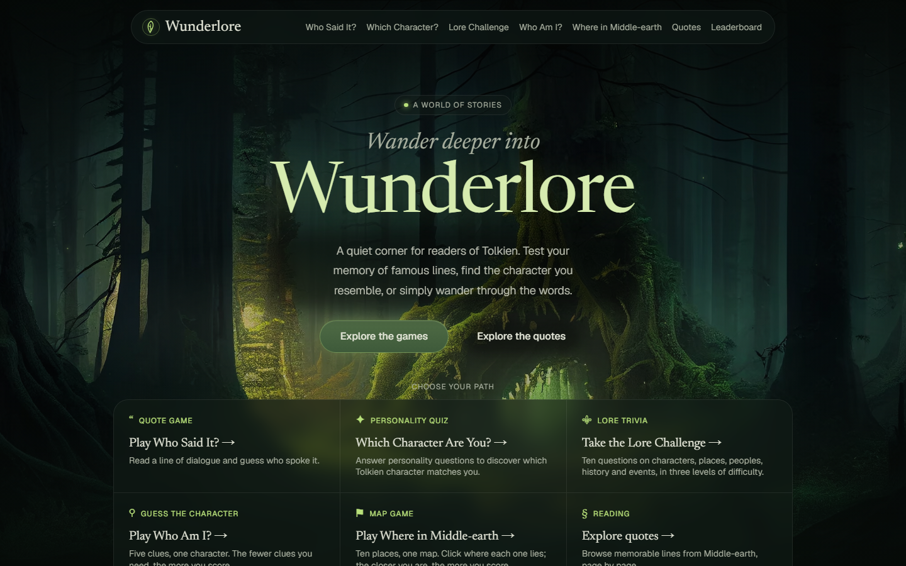

# Wunderlore


[](https://github.com/pitercoding/wunderlore/actions/workflows/backend-ci.yml)
[](https://github.com/pitercoding/wunderlore/actions/workflows/frontend-ci.yml)
[](LICENSE)

**Wunderlore** is a web app about Tolkien's world. You can browse quotes from the Middle-earth films and play five small games about its characters, places and history. Scores can be published to a leaderboard.

> **Wunderlore is a personal portfolio project and a fan project.** It shows a Java/Spring Boot REST API working together with a Next.js frontend. It is not a commercial product.
>
> Wunderlore is an unofficial fan project. It is not affiliated with, endorsed or sponsored by the Tolkien Estate or the rights holders of the film adaptations.

| | Link |
| --- | --- |
| **Live app** | [wunderlore.vercel.app](https://wunderlore.vercel.app/) |
| **Repository** | [github.com/pitercoding/wunderlore](https://github.com/pitercoding/wunderlore) |

The frontend is hosted on Vercel and the backend on Render. The leaderboard database is PostgreSQL on Neon. The backend and the database both run on free plans, so they can go to sleep when idle. The first request after a quiet period may be slow while they start again.



## Table of contents

- [Features](#features)
- [Games](#games)
- [Tech stack](#tech-stack)
- [Architecture](#architecture)
- [Project structure](#project-structure)
- [Running locally](#running-locally)
- [Environment variables](#environment-variables)
- [Testing](#testing)
- [Continuous integration](#continuous-integration)
- [Known limitations](#known-limitations)
- [Image credits](#image-credits)
- [Fan project notice](#fan-project-notice)
- [License](#license)

## Features

- **Five games** about Tolkien's world, each with its own page and scene.
- **Quotes**: browse memorable lines from the films, page by page, with the character who said each one.
- **Leaderboard**: publish a finished game with a nickname. Each game and difficulty level is ranked separately.
- **Difficulty levels**: easy, medium and hard in three of the games.
- **Fair play**: the backend keeps the correct answers and sends them only after you answer.
- **Friendly errors**: loading states, an error page with a retry button, and a hint when the backend is waking up.

## Games

| Game | How it works |
| --- | --- |
| **Lore Challenge** | A 10-question trivia game. Pick a category (characters, places, peoples, history, events, or all) and a difficulty. Questions come from a curated bank of 300. |
| **Who Am I?** | 10 rounds. Guess a character from up to five clues. The fewer clues you need, the more points you get (100 down to 20). |
| **Where in Middle-earth** | 10 places on an original map. Click where you think each place is. The closer you are, the more you score. |
| **Which Character Are You?** | A 10-question personality quiz. Your answers point to one of ten Tolkien characters. This game has no score, so it is not on the leaderboard. |
| **Who Said It?** | Read a line of dialogue and choose which character said it. You can play single rounds or a 10-question match. |

Lore Challenge, Who Am I? and Where in Middle-earth use curated data stored in the backend. Quotes and Who Said It? use [The One API](https://the-one-api.dev/documentation) and need an access token (see [Environment variables](#environment-variables)).

## Tech stack

| Area | Technology |
| --- | --- |
| **Frontend** | Next.js 16.4.3 (App Router), React 19.3.0, TypeScript 5, CSS Modules |
| **Backend** | Java 21, Spring Boot 4.1.2, Spring Web MVC, Maven (with the Maven Wrapper) |
| **Data** | PostgreSQL 18, Spring Data JPA, Flyway migrations (used only by the leaderboard) |
| **External data** | The One API, called by the backend |
| **Testing** | JUnit and Spring Boot test support (backend), Vitest and Testing Library (frontend) |
| **Linting** | ESLint with `eslint-config-next` |
| **Infrastructure** | Docker and Docker Compose, GitHub Actions, Vercel (frontend), Render (backend), Neon (production PostgreSQL) |

## Architecture

```text
Browser ──▶ Next.js frontend (Vercel) ──▶ Spring Boot API (Render) ──▶ The One API
                                                  │
                                                  └──▶ PostgreSQL (leaderboard only)
                                                       local: Docker · production: Neon
```

- The frontend calls the backend from the Next.js server. The backend URL is read from `API_URL` and is never sent to the browser.
- The backend holds the game rules and the correct answers. Game state lives in memory and is never saved. Only a published result is stored.
- PostgreSQL is optional. It is turned on with `WUNDERLORE_PERSISTENCE_ENABLED=true`. While it is off, every game still works and the leaderboard answers `503`.
- Game creation and leaderboard publishing have simple in-memory rate limits.
- The backend and frontend tests share JSON files in [`contracts/`](contracts), so both sides are checked against the same API shape.

## Project structure

```text
wunderlore/
├── .github/workflows/   # Backend CI and Frontend CI
├── backend/             # Spring Boot API
│   ├── src/main/java/com/wunderlore/
│   │   ├── client/theone/   # The One API client
│   │   ├── controller/      # Quotes, books and health endpoints
│   │   ├── game/            # The five games
│   │   ├── lore/            # Lore data loading
│   │   ├── persistence/     # Switch for the database layer
│   │   └── ranking/         # Leaderboard
│   ├── src/main/resources/  # Configuration, curated data, Flyway migrations
│   └── Dockerfile
├── contracts/           # Shared JSON fixtures for API tests
├── frontend/            # Next.js app
│   ├── public/images/   # Scene images and credits
│   └── src/
│       ├── app/         # Pages (home, games, quotes, leaderboard)
│       ├── components/  # Shared UI components
│       └── lib/         # API client functions, ranking and SEO helpers
├── compose.yaml         # Local PostgreSQL (and the backend container)
├── .env.example         # Backend and Docker Compose settings
└── LICENSE
```

## Running locally

### Prerequisites

- **Java 21**
- **Node.js 22** and npm
- **Docker with Docker Compose**, only if you want the leaderboard (it provides PostgreSQL)

You do not need to install Maven. The project includes the Maven Wrapper.

### 1. Get the code

```bash
git clone https://github.com/pitercoding/wunderlore.git
cd wunderlore
```

### 2. Configure the environment

```bash
cp .env.example .env
cp frontend/.env.example frontend/.env.local
```

- The root `.env` is read by the backend and by Docker Compose.
- `frontend/.env.local` is read by the frontend. It sets `API_URL=http://localhost:8080`.
- To use Quotes and Who Said It?, set `THE_ONE_API_ACCESS_TOKEN` in `.env`. You can get a token from [The One API](https://the-one-api.dev/documentation).
- `.env` files are ignored by Git. Never commit real tokens or passwords.

### 3. Start the backend

The backend must start before you use the frontend.

```bash
cd backend
./mvnw spring-boot:run
```

On Windows, use `mvnw.cmd spring-boot:run`.

The backend listens on port **8080**. To check it, open [localhost:8080/health](http://localhost:8080/health). It should answer:

```json
{"status":"UP"}
```

With the default settings the backend starts **without a database**. All five games work. The leaderboard answers `503`.

### 4. Start the frontend

In another terminal:

```bash
cd frontend
npm install
npm run dev
```

The frontend runs on port **3000**. Open [localhost:3000](http://localhost:3000) in your browser.

### Optional: enable the leaderboard

1. In `.env`, set a password of your choice: `DB_PASSWORD=<your-password>`.
2. In `.env`, set `WUNDERLORE_PERSISTENCE_ENABLED=true`.
3. Start PostgreSQL from the repository root:

   ```bash
   docker compose up -d postgres
   ```

   It listens on host port **5433**. The default `DB_URL` in `.env.example` already points to it.
4. Start (or restart) the backend. Flyway creates the leaderboard table when it starts.

### Ports

| Service | Port |
| --- | --- |
| Frontend (`npm run dev`) | 3000 |
| Backend | 8080 |
| PostgreSQL (Docker Compose) | 5433 on the host |

## Environment variables

Backend settings go in the root `.env`. See [`.env.example`](.env.example) for all comments.

| Variable | Required | Purpose |
| --- | --- | --- |
| `WUNDERLORE_PERSISTENCE_ENABLED` | No (default `false`) | Turns on PostgreSQL and the leaderboard |
| `DB_PASSWORD` | When persistence is on, and for Docker Compose | Database password. Use your own value |
| `DB_USERNAME` | For Docker Compose | Database user |
| `DB_NAME` | No | Database name for Docker Compose |
| `DB_PORT` | No (default `5433`) | Host port for the PostgreSQL container |
| `DB_URL` | No | JDBC URL used by the backend when run locally |
| `BACKEND_PORT` | No (default `8080`) | Host port for the backend container |
| `THE_ONE_API_ACCESS_TOKEN` | For Quotes and Who Said It? | Token for The One API |

Frontend settings go in `frontend/.env.local`. See [`frontend/.env.example`](frontend/.env.example).

| Variable | Required | Purpose |
| --- | --- | --- |
| `API_URL` | Yes | Base URL of the backend. It is read only on the server |

## Testing

```bash
# Backend (from backend/)
./mvnw verify

# Frontend (from frontend/)
npm test
npm run lint
npx next typegen && npx tsc --noEmit
npm run build
```

Backend tests do not need a database or a The One API token.

## Continuous integration

Two GitHub Actions workflows run on pushes and pull requests to `main`:

- [Backend CI](.github/workflows/backend-ci.yml): sets up Java 21 and runs `./mvnw verify`.
- [Frontend CI](.github/workflows/frontend-ci.yml): sets up Node.js and runs `npm ci`, lint, type check, tests and build.

## Known limitations

- A game in progress is kept in memory only. It is lost if the backend restarts, and it expires 30 minutes after it starts (10 minutes for a single Who Said It? round). Published leaderboard results are different: they are saved in PostgreSQL and are not lost.
- There are no user accounts. The leaderboard uses nicknames only.
- Quotes and Who Said It? depend on The One API and its token.
- The backend (Render) and the database (Neon) run on free plans. The first request after being idle can be slow.

## Image credits

The scene background images come from free image platforms. For most of them the author and licence were not recorded. Everything that is known, and what is not, is written in [`frontend/public/images/ATTRIBUTIONS.md`](frontend/public/images/ATTRIBUTIONS.md). The site footer links to it as "Image credits".

## Fan project notice

Wunderlore is an unofficial fan project. It is not affiliated with, endorsed or sponsored by the Tolkien Estate or the rights holders of the film adaptations.

## License

The source code is licensed under the [MIT License](LICENSE). Copyright (c) 2026 Piter Gomes.
